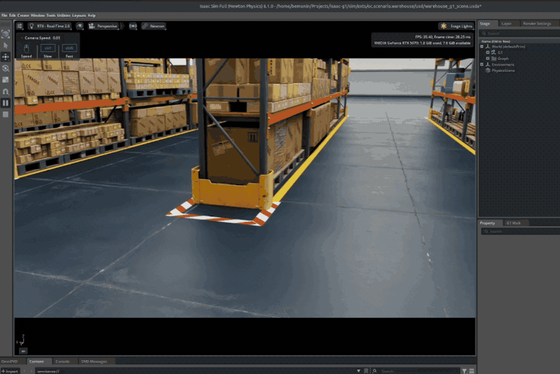
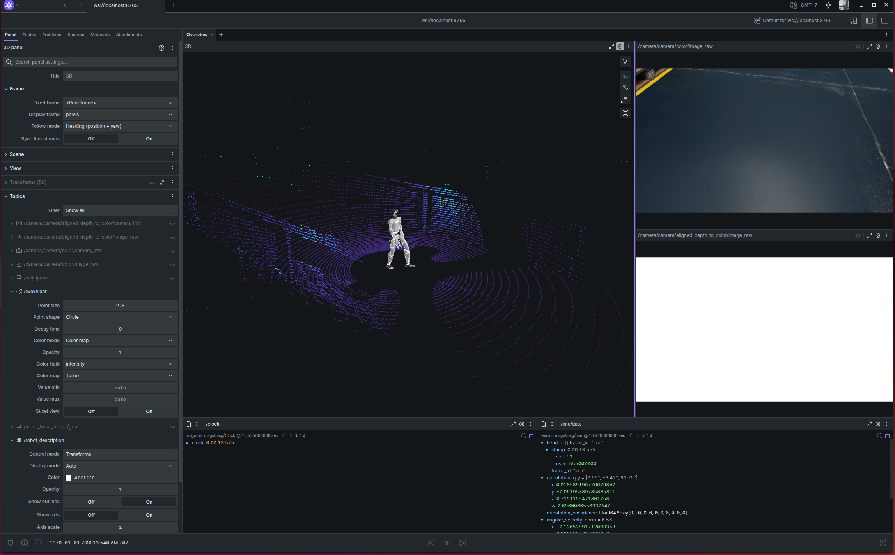

# isaac-g1

A Pixi-based Isaac Sim project for the Unitree G1, built for agentic AI workflows.
Connects to ROS 2 Jazzy over the DDS of your choice.



## Prerequisites

- Isaac Sim 6.2.0. The project targets the newest Isaac Sim release first.
- [Pixi](https://pixi.sh)
- Linux (Ubuntu 22.04 / 24.04) or Windows
- An NVIDIA RTX GPU that meets [Isaac Sim's requirements](https://docs.isaacsim.omniverse.nvidia.com/latest/installation/requirements.html)
- A coding agent such as Claude Code (for setup and the project skills)
- [Foxglove](https://foxglove.dev) (optional, to view topics)

## Setup

1. Install Pixi and clone this repo.
2. Open a coding agent in the repo root and initialize the project:
   - Claude Code: type `/init`.
   - Codex: type `$oc-init-proj`.

This installs the Pixi environments, downloads the SONIC weights, links the Isaac Sim package (`_isaacsim`), and loads the project's required skills from Isaac Sim Skills.

> [!NOTE]
> - In Claude Code, `/init` follows `AGENTS.md`'s Init section: it sets up the project without 
>   creating a `CLAUDE.md`. Howevery, Codex has no such hook, so run the skill directly.

## Getting started

Run the warehouse example to watch the G1 walk a loop through the hall, and inspect its topics in Foxglove.

1. Start the sim with ROS 2 on. Isaac Sim opens the warehouse and plays it; the G1 stands 2 s,
   then walks a loop through the hall.

   ```bash
   pixi run warehouse --ros
   ```

2. In a second terminal, build `ros_ws` (once, and after changing its packages) and start the
   Foxglove bridge with the G1's robot description:

   ```bash
   pixi run build
   pixi run foxglove
   ```

3. In Foxglove, open a connection to `ws://localhost:8765` to see the G1 model, lidar, camera, TF
   and IMU topics.

The sim uses the session's DDS (`pixi run dds` shows it). If it is `zenoh`, start the router with
`pixi run zenoh` before steps 1 and 2. See [DDS](#dds) and [Warehouse](#warehouse) for the options.

## DDS

Pick the ROS 2 middleware once; new Pixi sessions use it.

| Command | Does |
| --- | --- |
| `pixi run dds [fast\|cyclone\|zenoh]` | Select the DDS (no argument shows the current one) |
| `pixi run zenoh` | Start the Zenoh router (needed for `zenoh`) |
| `pixi run shell` | Open a ROS 2 shell in `ros_ws` |
| `pixi run build` | Build the ROS 2 packages in `ros_ws` |
| `pixi run foxglove` | Start the Foxglove bridge and the G1 robot description on `ws://localhost:8765` (`oc_foxglove_bridge`) |



## Warehouse

The warehouse example can run in many configurations, such as a different physics engine, workflow or headless mode:

```bash
pixi run warehouse                   # Standalone workflow, Newton, SONIC, with a window
pixi run warehouse --workflow ext    # Extension workflow
pixi run warehouse --physics physx   # PhysX instead of Newton
pixi run warehouse --headless        # no window
pixi run warehouse --ros             # publish the G1's ROS 2 topics and accept /cmd_vel (off by default)
pixi run warehouse -o clutter,forklift # Show floor clutter (boxes, crates, cones, signs) and the forklift; both are hidden by default.
```

The G1 uses SONIC whole-body control by default; download its weights once with
`pixi run sonic-download` first. `--dds fast|cyclone|zenoh` overrides the session's DDS. See
[`sim/exts/oc.scenario.warehouse`](sim/exts/oc.scenario.warehouse/docs/README.md).

## Control

**SONIC** ([`oc.control.g1_sonic`](sim/exts/oc.control.g1_sonic/docs/README.md)) moves the G1 with
NVIDIA SONIC whole-body control: slow walk, walk, run, side moves and turns, plus lower-body ground
moves — `squat`, `kneel`, `kneel_one_leg` and `crawl_hands`/`crawl_elbows`. Drive it from a
`MovementPlan` or one command at a time (`command(LocomotionCommand)`, `walk(cmd_vel)`, ...).
Download its weights once with `pixi run sonic-download`.

## Command over ROS

`pixi run warehouse-cmd` opens the warehouse with the G1 standing and ROS 2 on, and drives it with SONIC over
ROS 2 instead of the loop. Add `--headless` for no window, `--physics physx` for PhysX, `-o clutter,forklift`
for the warehouse props.

```bash
pixi run warehouse-cmd
```

- **Walk** with `geometry_msgs/Twist` on `/cmd_vel` (`linear.x` forward, `linear.y` left, `angular.z` turn).
- **Lower body** with `geometry_msgs/Twist` on `/posture_cmd`: `linear.x` picks the move — `0` stand, `4` squat,
  `5`/`6` kneel two/one leg, `8`/`14` hand/elbow crawl — and `linear.z` is the pelvis height [m] for the postures.
  A posture holds in place; a crawl is a low mode that `/cmd_vel` then drives. To stand up from elbow crawl, enter
  hand crawl (`8`) first, then stand (`0`).

```bash
pixi run ros2 topic pub --once /posture_cmd geometry_msgs/msg/Twist "{linear: {x: 4.0, z: 0.6}}"  # squat to 0.6 m
pixi run ros2 topic pub --once /posture_cmd geometry_msgs/msg/Twist "{linear: {x: 8.0}}"           # hand crawl; /cmd_vel then drives it
pixi run ros2 topic pub --once /posture_cmd geometry_msgs/msg/Twist "{linear: {x: 0.0}}"           # stand up
```

## Skills

Ask your coding agent to use these (in Claude Code, `/<name>`):

- `oc-init-proj`: install the Pixi envs and create the project symlinks; `/init` in Claude Code, `$oc-init-proj` in Codex.
- `oc-add-ext`: scaffold a new Isaac Sim extension.
- `oc-g1-ros`: add the G1 to a stage, work with its ROS 2 graphs, or add sensors.

The other skills in `.agents/skills/` are third-party Isaac Sim references. Agent rules live in
[`AGENTS.md`](AGENTS.md); project terms in [`GLOSSARY.md`](GLOSSARY.md).
